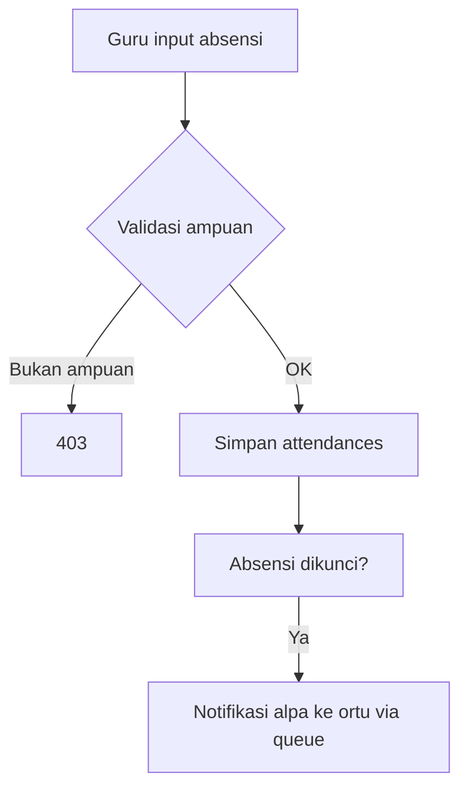

# Tentang Diagram (Graphify)

> Prinsip SOP §10: **diagram dibuat dari kode, bukan digambar manual.**

## Yang ada di sini

- `erd.md` — ERD (digenerate dari model Eloquent)
- `alur-*.md` — diagram alur bisnis per modul (digenerate via `php artisan docs:graph {modul}`)

Semua file di folder ini **dihasilkan otomatis** oleh CI (`docs:graph`). Jangan edit manual — perbaiki generatornya bila diagram salah.

## Cara regenerate lokal

```bash
php artisan docs:graph --all        # semua modul
php artisan docs:graph absensi      # satu modul
```

## Contoh (Mermaid — dirender native oleh Obsidian)



> Contoh di atas ilustratif — file `alur-absensi.md` yang asli digenerate dari kode (US-122).
